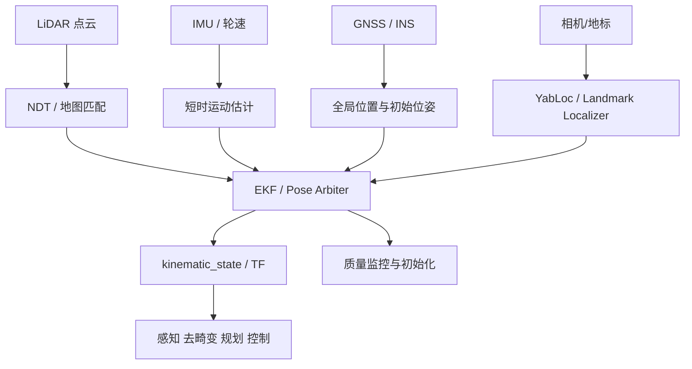
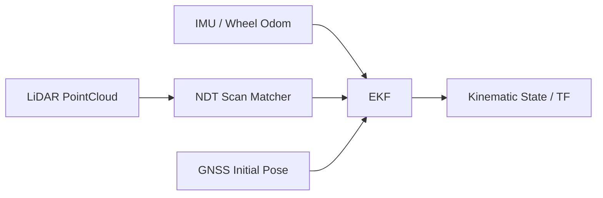
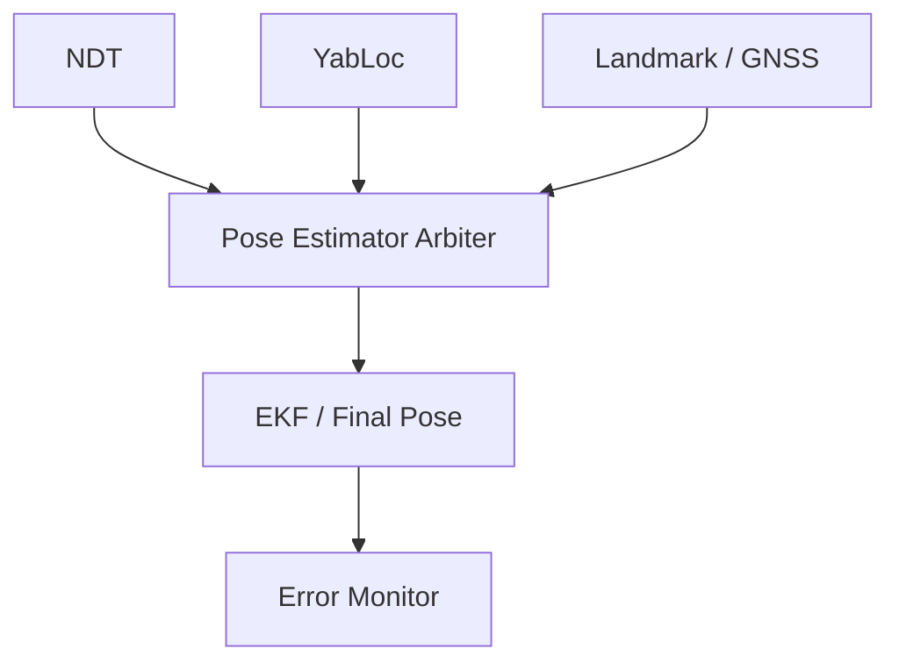
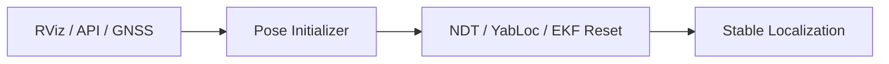

# Autoware 定位相关包功能与作用说明

**整理日期：2026-10-18**  
**范围：**用户列出的 Localization 目录包。7 月 15 日目录主要对应 `autoware_universe/localization`，9 月 30 日目录主要对应 `autoware_core/localization`。定位系统的目标是持续估计车辆在地图/地球坐标系中的位置、姿态、速度和不确定度，并为感知、规划和控制提供统一的 `kinematic_state`。

## 1. 定位总体架构

| 定位层次 | 主要问题 | 代表包 |
|---|---|---|
| 全局坐标与地图投影 | 经纬度如何转到 map/UTM/ENU | `autoware_geo_pose_projector`、`autoware_gnss_poser` |
| LiDAR 地图匹配 | 当前点云与地图如何对齐 | `autoware_ndt_scan_matcher` |
| 视觉/地标定位 | 没有可靠 LiDAR 匹配时如何定位 | `yabloc`、`autoware_landmark_based_localizer` |
| 惯性/运动融合 | 高频姿态、速度和预测 | `autoware_ekf_localizer`、`autoware_gyro_odometer` |
| 估计结果仲裁 | 多个 pose estimator 如何选 | `autoware_pose_estimator_arbiter` |
| 状态后处理 | covariance、twist、frame 和速度转换 | `autoware_pose_covariance_modifier`、`autoware_pose2twist`、`autoware_twist2accel` |
| 质量和安全监控 | 漂移、抖动、停止和定位失效 | `autoware_localization_error_monitor`、`autoware_pose_instability_detector`、`autoware_stop_filter` |
| Core 基础设施 | 稳定的基础定位节点和工具 | `autoware_core_localization`、`autoware_localization_util`、Core 定位包 |

Autoware 的定位启动框架支持 `ndt`、`yabloc`、`artag`、`eagleye` 等 pose source，默认常见选择是 NDT scan matcher；YabLoc 是基于相机/地图的另一种定位路径。genui{"citation":{"ref":"turn4search1"}} Core 仓库则持续接收 EKF、NDT、gyro odometer、pose initializer 等基础定位组件。genui{"citation":{"refs":["turn4search7","turn4search8"]}}

## 2. 地理坐标、GNSS 与初始位姿

### 2.1 `autoware_geo_pose_projector`

- **功能：**将地理坐标（经纬度、高程，必要时包含航向）投影为 Autoware 地图坐标系中的 pose。
- **输入：**GNSS/地理 pose、地图投影参数、地理参考系信息。
- **输出：**map/earth 坐标下的位置和姿态。
- **主要作用：**建立“经纬度世界”和“Lanelet2/map 坐标”的转换，是 GNSS 初定位、地图加载和全局 route 的基础。
- **注意：**投影类型、原点、UTM zone、ENU/NED、海拔基准和 frame_id 必须与地图一致。

### 2.2 `autoware_gnss_poser`（Autoware Core）

- **功能：**将 GNSS 定位和 GNSS/INS 姿态组合成可供 Autoware 使用的 pose。
- **主要作用：**为 EKF 提供绝对位置观测，或在启动时提供初始位姿；也可以作为无 LiDAR 地图匹配时的全局参考。
- **典型输入：**NavSatFix、GNSS orientation、地图投影/TF。
- **注意：**要正确处理 GNSS fix 状态、协方差、天线杆臂和航向有效性。

### 2.3 `autoware_pose_initializer`（Autoware Core）

- **功能：**集中管理定位初始化请求，将 RViz/API/GNSS 等来源的初始位姿转换为统一初始化流程。
- **主要作用：**让 EKF、NDT 和其他定位器在统一的服务/状态机下开始工作，避免多个模块同时重置滤波器。
- **注意：**Core 发布记录包含“拒绝过期 GNSS pose”和“去重触发模块”等修复，说明时间戳和重复触发是实际运行中的关键问题。genui{"ref":"turn4search6"}

## 3. LiDAR 地图匹配

### 3.1 `autoware_ndt_scan_matcher`（Autoware Core）

- **功能：**使用 NDT（Normal Distributions Transform）将当前 LiDAR 点云与预先构建的地图匹配，估计车辆 6DoF pose。
- **输入：**实时点云、局部/分块点云地图、初始 pose、车辆运动/TF。
- **输出：**匹配 pose、score、变换、协方差、诊断状态和定位质量指标。
- **主要作用：**在有高质量点云地图时提供高精度、连续的地图相对定位。
- **典型流程：**获取初始 guess → 加载/更新局部地图 → NDT 优化 → 评估 score/迭代次数/残差 → 发布 pose 和 covariance。
- **关键参数：**体素分辨率、步长、最大迭代次数、收敛阈值、初始 pose 搜索范围、地图更新半径和正则化。
- **注意：**初始位姿差距太大、地图与现场变化、雨雪/动态物体、点云密度不足都会造成错误收敛；地图分块过大也会影响动态加载和匹配性能。genui{"refs":["turn4search4","turn4search16","turn4search8"]}

## 4. 视觉和地标定位

### 4.1 `autoware_landmark_based_localizer`

这是一个地标定位集合，通常包含以下能力：

- **AR Tag/AprilTag 类定位：**识别已知视觉标记，根据标记在地图中的 pose 反推车辆 pose；
- **LiDAR marker localization：**从点云检测反光柱、路侧标记或其他已知 landmark；
- **Landmark manager：**管理地图中的地标、观测结果和关联关系。

**主要作用：**在 GNSS 不可靠、NDT 初始值差或需要局部重定位时，利用稀疏但高辨识度的地标提供绝对/相对 pose 修正。  
**注意：**地标地图、相机/雷达外参、检测误匹配和地标遮挡是主要风险。

### 4.2 `yabloc`

YabLoc 是基于相机和矢量地图的定位系统，通常由多个子包组成：

- `yabloc_image_processing`：提取道路边界、车道线、路面标记等视觉特征；
- `yabloc_particle_filter`：维护多个可能 pose，通过地图特征和运动模型逐步收敛；
- `yabloc_pose_initializer`：从粗略初始位置生成粒子分布或初始化状态；
- `yabloc_monitor`：监控视觉定位质量、收敛性和输入有效性；
- `yabloc_common`：共享消息、几何、地图和配置工具。

**输入：**相机图像、Lanelet2/vector map、车辆运动/初始 pose。  
**输出：**相机/地图匹配 pose、质量指标和 debug 可视化。  
**主要作用：**提供 NDT 之外的视觉定位来源，在地图中车道线、道路边缘和标记清晰时提高鲁棒性。  
**注意：**天气、光照、车道线磨损、地图标签差异和训练/部署域差距会影响结果；定位启动文档明确将 YabLoc 作为可选 pose source。genui{"refs":["turn4search1","turn4search2","turn4search20"]}

## 5. 状态估计与运动推算

### 5.1 `autoware_ekf_localizer`（Autoware Core）

- **功能：**扩展卡尔曼滤波器（EKF），融合 pose、twist、IMU、轮速、GNSS 和 NDT 等观测。
- **预测状态：**位置、姿态、线速度、角速度、加速度及其协方差（具体状态向量由版本参数定义）。
- **输入：**高频 odometry/IMU/速度，以及低频绝对 pose 观测。
- **输出：**平滑、连续的 `nav_msgs/Odometry`/kinematic state、TF、协方差和诊断。
- **主要作用：**把离散、异步、有噪声的定位来源融合成控制和感知可使用的连续状态。
- **注意：**协方差、观测延迟、frame、时间回溯、初始 pose 和 measurement gate 是调参重点。Core 版本已从 Universe 迁移并持续增加无 ROS 核心逻辑测试。genui{"refs":["turn4search10","turn4search6","turn4search12"]}

### 5.2 `autoware_gyro_odometer`（Autoware Core）

- **功能：**利用陀螺仪角速度和车辆运动模型估计短时 odometry/航向变化。
- **输入：**IMU gyro、车辆速度/轮速、必要时转向角或 steering 状态。
- **输出：**短时 twist/odometry、角度变化和诊断。
- **主要作用：**在 NDT/GNSS 更新之间提供高频运动预测，辅助 EKF、点云去畸变和跟踪。
- **注意：**陀螺偏置、车辆速度参考点和转弯模型会影响长期漂移；它通常不能独立替代绝对定位。

### 5.3 `autoware_pose2twist`

- **功能：**根据连续 pose 计算线速度和角速度 twist。
- **输入：**带时间戳的 pose 序列/odometry。
- **输出：**`TwistWithCovarianceStamped` 或等价速度消息。
- **主要作用：**给没有直接速度输出的定位器、轨迹回放和仿真数据补充速度估计。
- **注意：**时间间隔、姿态差分方式、坐标系和噪声放大必须处理；低频/抖动 pose 会产生不稳定速度。

### 5.4 `autoware_twist2accel`（Autoware Core）

- **功能：**根据连续 twist/速度估计线加速度和角加速度。
- **主要作用：**为控制、规划、轨迹预测和 EKF 提供加速度信息。
- **注意：**差分会放大速度噪声，需要滤波、时间间隔检查和异常值保护；Core 版本属于基础定位/运动接口组件。genui{"ref":"turn4search8"}

## 6. Pose 后处理、仲裁与质量监测

### 6.1 `autoware_pose_covariance_modifier`

- **功能：**修改或重构 pose/twist 的 covariance。
- **用途：**修正传感器未提供、过小、过大或不符合融合假设的不确定度；为 EKF/下游 gating 提供合理权重。
- **注意：**covariance 不是“越小越好”；虚假低协方差会让错误观测压制其他定位源。

### 6.2 `autoware_pose_estimator_arbiter`

- **功能：**在 NDT、YabLoc、landmark、GNSS 等多个 pose estimator 之间进行选择、切换或加权仲裁。
- **主要作用：**当某个定位源质量下降、失锁或暂时不可用时，选择仍然可信的 pose，并避免瞬时跳变。
- **典型依据：**定位 score、协方差、时间戳新鲜度、收敛状态、速度一致性和来源优先级。
- **注意：**切换应带滞回、超时和坐标对齐，否则会出现 pose jump。

### 6.3 `autoware_localization_error_monitor`

- **功能：**监控定位结果与参考、地图、传感器或运动模型之间的误差。
- **典型检查：**NDT score、GNSS/NDT 差异、pose jump、速度/加速度异常、协方差过大、TF 断链和数据超时。
- **主要作用：**发布诊断状态、触发降级或向系统报告定位不可用。

### 6.4 `autoware_pose_instability_detector`

- **功能：**检测 pose 在短时间内的异常抖动、跳变、振荡和不连续。
- **主要作用：**识别“平均误差不大但局部不稳定”的定位故障，避免感知投影、规划和控制被瞬时 pose 破坏。
- **典型策略：**位置/姿态窗口方差、相邻差分、速度一致性、频率和持续时间阈值。

### 6.5 `autoware_stop_filter`

- **功能：**识别车辆停止状态，过滤/冻结停止期间不应变化的速度或 pose 派生量。
- **主要作用：**减少车辆静止时 IMU 噪声、轮速量化和 pose 微抖造成的虚假运动。
- **注意：**停止阈值和解除停止条件应结合车辆最低可测速度，否则可能在低速爬行时错误冻结。

## 7. Core 公共工具

### 7.1 `autoware_core_localization`

- **功能：**Core localization 元包/组织入口，汇总 EKF、NDT、gyro odometer、pose initializer、localization utility 等基础组件。
- **主要作用：**统一构建、安装、依赖和启动集成；不是单独的定位算法。

### 7.2 `autoware_localization_util`

- **功能：**提供定位模块共享的几何、角度、协方差、坐标变换、数值和诊断工具。
- **主要作用：**减少 EKF、NDT、gyro odometer 等包重复实现基础数学逻辑。
- **注意：**属于库包，通常不独立发布定位 topic。

## 8. 推荐定位组合

### LiDAR 地图定位主链路

### 多源定位仲裁

### 启动与重定位

## 9. 选型建议

| 场景 | 推荐方案 |
|---|---|
| 有高质量点云地图、需要厘米级相对定位 | `autoware_ndt_scan_matcher` + `autoware_ekf_localizer` |
| GNSS 可用、需要全局初始位置 | `autoware_geo_pose_projector` + `autoware_gnss_poser` + EKF |
| NDT 初始位姿差或局部重定位 | `autoware_landmark_based_localizer` 或 `yabloc` |
| 需要高频短时运动估计 | `autoware_gyro_odometer` + EKF |
| 多个定位器同时运行 | `autoware_pose_estimator_arbiter` |
| 需要检测定位抖动和漂移 | `autoware_localization_error_monitor` + `autoware_pose_instability_detector` |
| 只有 pose 没有速度 | `autoware_pose2twist` |
| 只有 twist 没有加速度 | `autoware_twist2accel` |
| 观测权重不合理 | `autoware_pose_covariance_modifier` |
| 停车时速度/姿态噪声 | `autoware_stop_filter` |

## 10. 排障重点

1. **地图和坐标系：**确认 map、earth、base_link、sensor frame、Lanelet2 原点和地理投影完全一致；
2. **NDT 初始值：**初始 pose 偏差过大时，NDT 可能收敛到错误局部最优；
3. **地图质量：**地图分辨率、分块大小、动态加载半径和现场变化会影响匹配；
4. **时间同步：**IMU、LiDAR、GNSS、odom 与 TF 的时间戳必须一致，尤其是去畸变和 EKF 延迟补偿；
5. **协方差：**检查 covariance 是否为 NaN、全零或不合理地过小；
6. **姿态约定：**确认 ENU/NED、四元数顺序、yaw 定义和角度单位；
7. **天线/传感器杆臂：**GNSS 天线、LiDAR、IMU 相对车辆参考点的外参不能忽略；
8. **定位源切换：**检查 arbiter 的优先级、滞回、超时和坐标对齐；
9. **视觉/地标误匹配：**检查 landmark ID、地图位置、相机外参和遮挡；
10. **停止状态：**确认 stop filter 是否错误冻结低速运动，或将 IMU 噪声当成真实速度；
11. **初始化：**确保只由 pose initializer 触发 reset，避免 RViz、GNSS 和其他模块重复初始化；
12. **降级策略：**定位失效时应停止输出旧 pose，或明确进入安全模式，不应无提示继续使用过期定位。

## 11. 官方参考

- [Autoware Localization 启动与配置说明](https://autowarefoundation.github.io/autoware-documentation/main/tutorials/integrating-autoware/launch-autoware/localization/)
- [Autoware Core 仓库](https://github.com/autowarefoundation/autoware_core/tree/main/localization)
- [Autoware Universe 仓库](https://github.com/autowarefoundation/autoware_universe/tree/main/localization)
- [Autoware NDT Scan Matcher 源码](https://github.com/autowarefoundation/autoware_core/tree/main/localization/autoware_ndt_scan_matcher)
- [Autoware EKF Localizer 源码](https://github.com/autowarefoundation/autoware_core/tree/main/localization/autoware_ekf_localizer)
- [YabLoc 相关目录](https://github.com/autowarefoundation/autoware_universe/tree/main/localization/yabloc)

> **版本提醒：**用户目录中 Universe 与 Core 包的时间戳不同，可能对应不同版本。本文说明功能边界和典型架构；实际 topic、服务、参数和消息字段必须以本地源码及 launch 配置为准。
