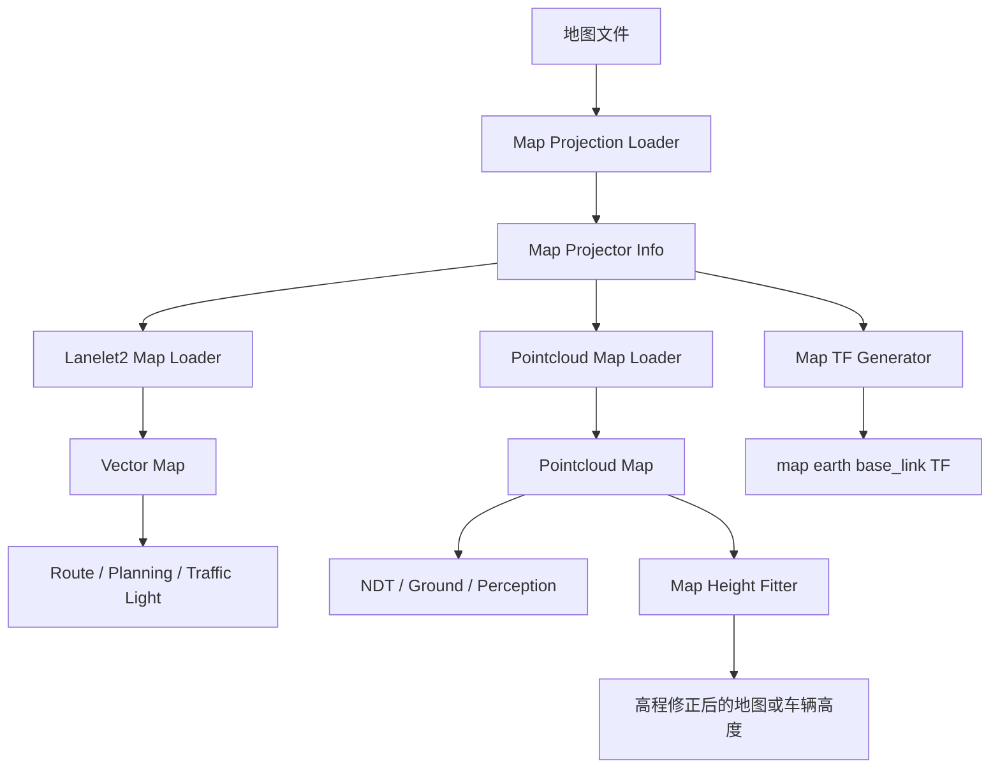
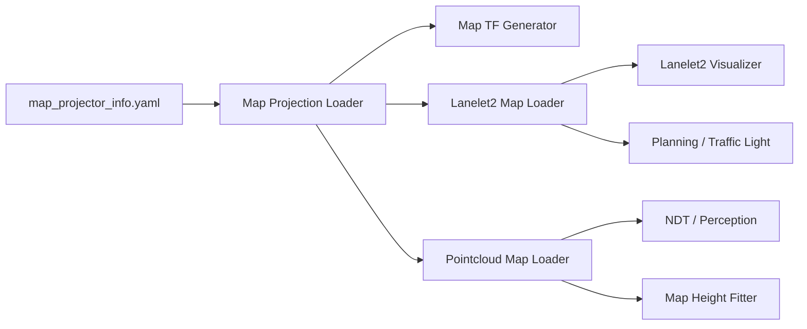

# Autoware 地图与坐标变换相关包功能说明

**整理日期：2026-10-18**  
**范围：**用户列出的地图相关包。`autoware_core_map`、`autoware_lanelet2_map_visualizer`、`autoware_map_height_fitter`、`autoware_map_loader`、`autoware_map_projection_loader` 属于 Autoware Core；`autoware_map_tf_generator` 和 `util` 来自 Universe 或本地工作区的地图工具目录。

## 1. 地图系统在 Autoware 中的作用



| 包 | 主要职责 | 面向的数据 |
|---|---|---|
| `autoware_map_projection_loader` | 发布地图投影类型和参数 | `map_projector_info.yaml`、Lanelet2 |
| `autoware_map_loader` | 加载 Lanelet2 和点云地图 | `.osm`、`.pcd`、metadata |
| `autoware_map_tf_generator` | 发布地图相关 TF | `map`、`earth`、`base_link` |
| `autoware_map_height_fitter` | 将车辆/地图高度对齐 | 点云、pose、地图高程 |
| `autoware_lanelet2_map_visualizer` | 将 Lanelet2 转成 RViz marker | Lanelet2 map |
| `autoware_core_map` | Core 地图元包/组织入口 | Core map modules |
| `util` | 脚本和地图处理辅助工具 | 地图转换、检查、分割等 |

Core 的地图接口由 `map_projector_info`、Lanelet2 二进制地图和点云地图组成；官方地图架构文档明确指出 Lanelet2 loader 发布 `autoware_map_msgs/msg/LaneletMapBin`。genui{"refs":["turn5search13","turn5search4"]}

## 2. 坐标投影与 TF

### 2.1 `autoware_map_projection_loader`

- **功能：**发布 `map_projector_info`，定义 Autoware 使用的地图坐标投影类型和参数。
- **解决的问题：**将全球坐标（经纬度、geoid）与本地地图坐标（x、y、z）互相转换。
- **输入：**通常是 `map_projector_info.yaml`；旧接口也可以从 Lanelet2 地图读取 MGRS 网格。
- **输出：**`autoware_map_msgs/msg/MapProjectorInfo`。
- **主要作用：**让 GNSS poser、Lanelet2 loader、地图工具和地理坐标转换使用同一套投影。
- **推荐做法：**显式准备 YAML；官方 README 将“从 Lanelet2 推断 MGRS”标为旧接口/不推荐方式。genui{"ref":"turn5search0"}
- **常见投影：**MGRS、UTM、Local Cartesian 等，具体以消息定义和版本为准。

### 2.2 `autoware_map_tf_generator`

- **功能：**根据地图原点、投影信息和车辆/地图配置发布静态或准静态 TF。
- **典型关系：**`earth → map`、`map → base_link` 的初始参考，或地图坐标与车辆坐标之间的辅助变换。
- **主要作用：**让点云地图、Lanelet2 地图、定位结果、RViz 和感知模块处于同一 TF 树。
- **注意：**它不负责车辆实时定位；车辆实时 pose 仍由 EKF/NDT 等定位器发布。重复发布同一 TF 会导致 TF 冲突和跳变。

## 3. 地图加载

### 3.1 `autoware_map_loader`

这是地图加载的核心包，通常包含 Lanelet2 和点云地图两类 loader。

#### 点云地图加载

- 支持发布原始点云地图；
- 支持发布降采样点云地图；
- 支持按 cell 通过 service 加载 partial map；
- 支持 differential map loading（按变化更新）；
- 支持单个 `.pcd` 或按网格分割的多个 `.pcd` 文件。

官方说明推荐大地图使用分块地图，以支持 partial/differential loading；分块应使用平行于 x/y 的直线、不重叠、网格尺寸一致，常见建议约 20 m × 20 m，过大的 cell 会影响 NDT 和地图分割模块的动态加载。genui{"refs":["turn5search4","turn5search2"]}

#### Lanelet2 地图加载

- 读取一个或多个 `.osm` 文件；
- 将多个文件合并为 `LaneletMapBin`；
- 按 `map_projector_info` 将经纬度投影到 Autoware 地图坐标；
- 可建立 cell bounding-box metadata；
- 可通过 selected-map service 返回指定 cell 的 Lanelet2 子地图。

**主要作用：**给规划、交通灯、路线处理、地图可视化和地图感知提供统一的静态道路语义。

**典型输入：**

```text
lanelet2_map.osm
pointcloud_map.pcd 或分块 PCD
pointcloud_map_metadata.yaml
map_projector_info.yaml
```

**典型输出：**

- `/map/vector_map`：Lanelet2 二进制地图；
- 点云地图 topic；
- 地图 cell metadata；
- partial/selected map service。

**注意：**地图投影、点云地图和 Lanelet2 必须使用同一个坐标系；缺失 `.osm`、metadata 或 projection 配置时应 fail-fast，而不是静默发布错误地图。

### 3.2 `autoware_core_map`

- **功能：**Autoware Core 的地图元包/组织入口。
- **主要作用：**统一 Core 地图组件的构建、安装和依赖；通常不单独实现加载、投影或可视化算法。
- **包含关系：**与 `autoware_map_loader`、`autoware_map_projection_loader`、`autoware_map_height_fitter` 等基础包协同使用。

## 4. 地图高程与车辆高度

### 4.1 `autoware_map_height_fitter`

- **功能：**根据点云地图、车辆 pose 和局部地面信息，估计并修正车辆/地图之间的高度偏差。
- **典型问题：**地图由不同测量设备生成，z 高程基准与实时定位、车辆姿态或点云地面不一致；小的 z 偏差会使 NDT、地面分割、障碍物高度和规划边界产生误差。
- **输入：**点云地图、实时点云/pose、车辆参考点和地图查询结果。
- **输出：**高度修正量、拟合后的 pose 或地图高度结果（具体接口以版本为准）。
- **主要作用：**让车辆在坡道、起伏道路和存在测量偏差的地图中保持合理 z 对齐。
- **注意：**动态物体、路缘、桥梁和稀疏地图会污染拟合；应限制搜索区域和高度异常值。Core release 记录中提到该包使用缓存 KdTree kernel 优化性能。genui{"ref":"turn5search6"}

## 5. Lanelet2 可视化

### 5.1 `autoware_lanelet2_map_visualizer`

- **功能：**将 Lanelet2 道路元素转换为 RViz marker/marker array。
- **可视化对象：**车道边界、中心线、车道属性、交通规则、交叉口、停车线、信号灯、区域和 route 信息。
- **主要作用：**验证地图是否加载、投影是否正确、车道拓扑是否连通、交通灯/停止线是否关联正确。
- **注意：**可视化结果不是规划输入本身；如果 marker 正确但规划错误，应继续检查 Lanelet2 message、route handler 和参数。
- **常见排障：**检查 marker frame、`/map/vector_map` 是否有数据、RViz Fixed Frame 是否设为 map、地图颜色/namespace 是否冲突。

## 6. `util` 目录

用户给出的 `util` 没有完整包名，无法仅凭目录名确定它属于哪一个仓库或哪套工具。通常此类目录可能包含：

- 地图分块/合并脚本；
- PCD metadata 生成器；
- Lanelet2/Osm 检查和转换工具；
- 坐标投影、原点或 frame 计算脚本；
- 地图可视化和数据质量检查工具。

**建议：**以本地 `util/README.md`、`package.xml`、`setup.py`、`CMakeLists.txt` 或脚本帮助信息为准；不要把它当作一个可直接启动的 ROS 节点。

## 7. 推荐地图启动顺序



建议先确认 `map_projector_info` 和 TF，再启动 Lanelet2/PCD loader，最后启动 NDT、规划和感知。这样可以避免下游节点先收到错误 frame 或空地图。

## 8. 地图文件组织建议

```text
map_root/
├── lanelet2_map.osm
├── map_projector_info.yaml
├── pointcloud_map.pcd                 # 小地图可使用
├── pointcloud_map_metadata.yaml       # 分块地图必须提供
├── pointcloud_map/
│   ├── 0000.pcd
│   ├── 0001.pcd
│   └── ...
└── height/                            # 若项目单独提供高程辅助数据
```

分块 PCD 的 metadata 至少应表达每个文件对应的 x/y 起点和网格分辨率；所有 PCD 必须投影在与 Lanelet2 相同的坐标系中。官方文档特别指出，过大的分块尺寸可能影响 NDT 动态地图加载和 `autoware_compare_map_segmentation`。genui{"ref":"turn5search4"}

## 9. 选型建议

| 需求 | 主要包 |
|---|---|
| 读取道路语义地图 | `autoware_map_loader` 的 Lanelet2 loader |
| 读取 LiDAR 点云地图 | `autoware_map_loader` 的 pointcloud loader |
| 地理坐标与本地 map 转换 | `autoware_map_projection_loader` |
| 发布初始地图/车辆 TF | `autoware_map_tf_generator` |
| 处理地图与车辆 z 高程差 | `autoware_map_height_fitter` |
| 在 RViz 检查 Lanelet2 | `autoware_lanelet2_map_visualizer` |
| Core 地图系统集成 | `autoware_core_map` |
| 地图切块、metadata、检查 | `util` 中的脚本，需按本地实现确认 |

## 10. 常见问题与排障

1. **地图完全不显示：**检查 `.osm/.pcd` 路径、权限、launch 参数和 RViz Fixed Frame；
2. **Lanelet2 与点云错位：**检查两者是否使用相同投影、原点、UTM/MGRS zone 和 frame；
3. **GNSS 与地图偏移：**检查 `map_projector_info.yaml`、地理基准、天线杆臂和 `earth→map` TF；
4. **NDT 匹配失败：**检查点云地图是否为空/过稀、分块是否过大、动态物体是否过多、初始 pose 是否合理；
5. **动态加载缺块：**检查 cell metadata、x/y 分辨率、文件命名、边界是否重叠和 service 请求的 cell ID；
6. **高度漂移：**检查地图 z 基准、车辆安装高度、点云地面和 map height fitter 的搜索窗口；
7. **RViz marker 异常：**检查 marker frame、namespace、时间戳和地图是否已投影；
8. **TF 冲突：**确保只有一个节点负责发布同一对 frame 的静态变换；
9. **地图加载耗时高：**使用分块地图、降采样地图和 selected/partial loading；
10. **Core/Universe 混用：**逐项对照 topic、service、message、参数 YAML 和 map metadata 格式，不要只替换包名。

## 11. 官方参考

- [Autoware Core Map Loader](https://github.com/autowarefoundation/autoware_core/blob/main/map/autoware_map_loader/README.md)
- [Autoware Core Map Projection Loader](https://github.com/autowarefoundation/autoware_core/blob/main/map/autoware_map_projection_loader/README.md)
- [Autoware Core Map 仓库](https://github.com/autowarefoundation/autoware_core/tree/main/map)
- [Autoware Universe Map 目录](https://github.com/autowarefoundation/autoware_universe/tree/main/map)
- [Autoware Map 接口文档](https://github.com/autowarefoundation/autoware-documentation/blob/main/docs/design/autoware-architecture-v1/interfaces/components/map.md)
- [地图加载讨论示例](https://github.com/orgs/autowarefoundation/discussions/4103)

> **版本提醒：**用户目录中的 Core 包与 Universe 包时间戳不同，可能对应不同版本。本文说明功能与架构角色；实际 topic、service、参数名、地图 metadata 和 TF 关系应优先以本地源码为准。
