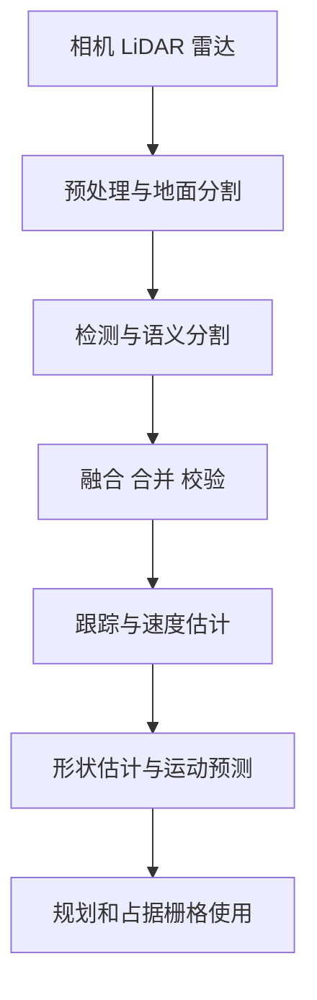
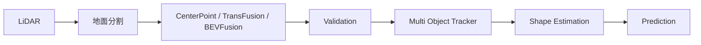
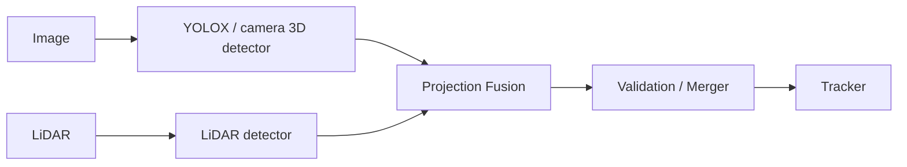
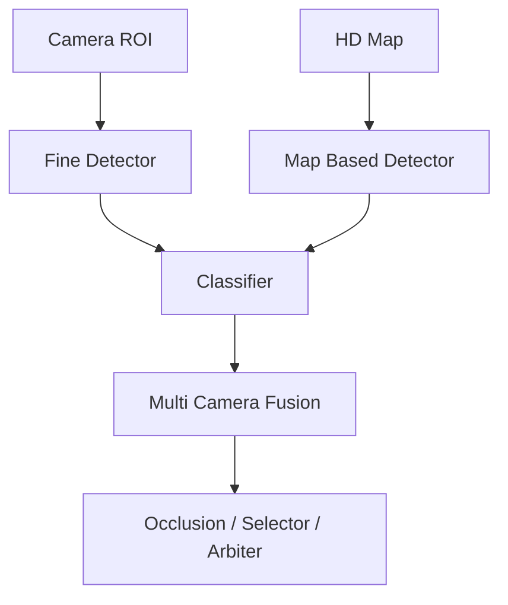

# Autoware 感知相关包功能与作用说明

**整理日期：2026-10-18**  
**适用范围：**用户列出的 Autoware 感知包目录。本文以 Autoware 官方公开仓库当前主分支 README、节点接口说明和包名语义为依据，重点说明“它解决什么问题、在感知流水线中的位置、典型输入输出和使用注意事项”。具体参数、消息字段和模型文件应以实际 checkout 的 commit 为准。

## 1. 总体定位

这些包共同覆盖了自动驾驶感知链路中的六个阶段：

| 类别 | 主要输出 | 典型包 |
|---|---|---|
| 点云预处理 | 去地面点云、聚类 | `autoware_ground_segmentation`、`autoware_ground_filter`、`autoware_euclidean_cluster` |
| 深度学习检测 | `DetectedObjects` | `autoware_lidar_centerpoint`、`autoware_lidar_transfusion`、`autoware_bevfusion` |
| 图像检测/分割 | 图像目标、交通灯、语义标签 | `autoware_tensorrt_yolox`、`autoware_camera_streampetr`、`autoware_lidar_frnet` |
| 多传感器融合 | 更完整的类别、位置和置信度 | `autoware_image_projection_based_fusion`、`autoware_tracking_object_merger`、`autoware_radar_fusion_to_detected_object` |
| 跟踪与后处理 | 稳定 ID、速度、过滤后的目标 | `autoware_multi_object_tracker`、`autoware_bytetrack`、`autoware_shape_estimation` |
| 预测与占据 | 目标未来轨迹、占据概率图 | `autoware_map_based_prediction`、`autoware_simpl_prediction`、`autoware_probabilistic_occupancy_grid_map` |
| 交通灯 | 灯色、遮挡、跨相机结果 | `autoware_traffic_light_classifier`、`autoware_traffic_light_multi_camera_fusion` 等 |
| 基础设施 | TensorRT 插件、公共工具、元包 | `autoware_tensorrt_common`、`autoware_tensorrt_plugins`、`perception_utils` |

多数目标检测包的核心接口是：输入 `sensor_msgs/msg/PointCloud2`、`sensor_msgs/msg/Image` 和/或 `CameraInfo`，输出 `autoware_perception_msgs/msg/DetectedObjects`；跟踪和预测则分别输出 `TrackedObjects`、`PredictedObjects` 或其对应数组。实际 topic 名称由 launch 文件重映射，不能只根据包名假定固定 topic。

## 2. 深度学习检测与分割

### 2.1 `autoware_bevfusion`

- **功能：**基于 LiDAR，或 LiDAR+相机融合，在统一鸟瞰图（BEV）空间执行 3D 目标检测。
- **核心算法：**BEVFusion；TensorRT 推理，稀疏卷积后端对应 spconv。
- **输入：**点云（通常要求 `PointXYZIRC` 布局）；相机图像和 `CameraInfo`（启用相机-LiDAR模型时）。
- **输出：**`DetectedObjects`，并发布预处理、推理、后处理和端到端延迟调试数据。
- **主要作用：**在同一模型中利用 LiDAR 几何信息和相机纹理/类别信息，提高远距离、弱点云和类别识别能力。
- **注意：**依赖 ONNX/TensorRT engine、标定和模型类别 remapper；模型类别数必须与配置匹配。官方 README 明确支持 `build_only` 预构建 engine，且当前包结构对完整相机-LiDAR集成仍有演进空间。

### 2.2 `autoware_camera_streampetr`

- **功能：**仅使用多路相机进行 3D 目标检测。
- **核心算法：**StreamPETR，将多视角图像特征与时间记忆融合，在 BEV/3D 空间输出目标。
- **输入：**多路 RGB 图像、相机内外参/`CameraInfo`，通常还需要时间同步和 ego-motion 相关信息。
- **输出：**3D `DetectedObjects` 及 TensorRT 处理耗时。
- **主要作用：**在没有 LiDAR 或希望降低 LiDAR 依赖时提供摄像头主导的 3D 感知。
- **注意：**对相机标定、同步、曝光和模型输入分辨率敏感；需要预先生成 TensorRT engine。

### 2.3 `autoware_lidar_centerpoint`

- **功能：**LiDAR 3D 动态目标检测。
- **核心算法：**CenterPoint 风格的点云 BEV 检测头，通常直接回归目标中心、尺寸、方向、速度和类别。
- **输入/输出：**点云 → `DetectedObjects`。
- **主要作用：**Autoware 中常用的高性能 LiDAR 检测基线，适合车辆、行人、骑行者等目标。
- **注意：**模型体素范围、点云坐标系、类别映射和检测范围必须与训练配置一致；通常需要 TensorRT engine 和 CUDA。

### 2.4 `autoware_lidar_transfusion`

- **功能：**使用 `(x,y,z,intensity)` LiDAR 点云进行 3D 目标检测。
- **核心算法：**TransFusion，TensorRT 负责预处理和神经网络推理。
- **输入/输出：**点云 → `DetectedObjects`，带分阶段耗时调试话题。
- **主要作用：**作为 CenterPoint 之外的 LiDAR 检测器，利用 transformer/注意力式候选目标建模提升检测质量。
- **注意：**支持 `build_only` 构建 engine；点云字段、模型类别和 remapper 要严格一致。

### 2.5 `autoware_lidar_apollo_instance_segmentation`

- **功能：**对 LiDAR 点云进行障碍物实例分割，并生成目标。
- **核心算法：**CNN 点云分割 + 障碍物聚类，思路源自 Apollo 感知方案。
- **输入/输出：**点云 → 障碍物/`DetectedObjects`，通常还可输出调试聚类结果。
- **主要作用：**把点级语义或实例结果转换为车辆、卡车、自行车、行人等 3D 障碍物。
- **注意：**聚类阈值、点云密度与传感器安装高度会显著影响结果。

### 2.6 `autoware_lidar_frnet`

- **功能：**LiDAR 3D 语义分割。
- **核心算法：**FRNet 类点云语义分割网络。
- **输入：**带 `x,y,z,intensity` 的点云。
- **输出：**逐点语义标签/带标签点云，供地面、道路、障碍物等下游处理。
- **主要作用：**提供比“检测框”更细粒度的场景理解，可用于障碍物提取和可行驶区域判断。

### 2.7 `autoware_ptv3`

- **功能：**基于 Point Transformer V3（PTv3）进行 3D LiDAR 语义分割。
- **输入/输出：**点云 → 逐点语义标签或标签点云。
- **主要作用：**面向现代 transformer 点云模型的高精度语义分割实现。
- **注意：**模型、CUDA/TensorRT 版本和点云预处理必须与训练发布物匹配。

### 2.8 `autoware_tensorrt_bevdet`

- **功能：**将多视角图像统一到 BEV 视角，执行 3D 目标检测。
- **核心算法：**BEVDet；图像 backbone、视角变换和 BEV detection head 通过 TensorRT 加速。
- **输入/输出：**多路图像与标定 → 3D `DetectedObjects`。
- **主要作用：**摄像头-only 的 BEV 检测方案，适合需要多相机全景覆盖的系统。

### 2.9 `autoware_tensorrt_bevformer`

- **功能：**多视角图像 3D 检测，并进行时间融合。
- **核心算法：**BEVFormer 的时序 BEV 特征建模。
- **输入/输出：**多相机图像、标定、时序信息 → 3D `DetectedObjects`。
- **主要作用：**通过历史帧改善遮挡、远距离和单帧不稳定问题。
- **注意：**时序缓存需要正确的时间戳、车辆运动和帧丢失处理。

### 2.10 `autoware_tensorrt_yolox`

- **功能：**基于 YOLOX 的 2D 目标检测/图像分割；也可切换到交通灯检测模型。
- **输入/输出：**图像 → 2D bounding boxes、类别和置信度，供 locator、投影融合或交通灯模块使用。
- **主要作用：**提供轻量、低延迟的图像目标候选。
- **注意：**模型 label 文件、类别顺序和输出头必须匹配；该包的检测、分割和交通灯模式不是同一套类别定义。

## 3. 点云预处理、地面分割与聚类

### 3.1 `autoware_ground_segmentation`

- **功能：**从输入点云中移除地面点。
- **算法：**按射线/径向排列点，依据相邻点的几何关系估计地面；具体实现包含 scan/scan-ray 类方法。
- **输入/输出：**点云 → 非地面点云，通常另有地面点云和调试输出。
- **主要作用：**降低后续聚类和检测的背景点数量，减少道路平面造成的误检。

### 3.2 `autoware_ground_segmentation_cuda`

- **功能：**GPU/CUDA 加速的地面分割实现。
- **主要作用：**缓解大点云在 CPU 地面分割中的延迟，并减少必须通过 crop box 截断点云范围而导致的坡道前方目标丢失。
- **注意：**依赖 CUDA 设备和相应 GPU 点云库；需要评估 CPU/GPU 数据拷贝成本。

### 3.3 `autoware_compare_map_segmentation`

- **功能：**利用地图高程/点云信息过滤输入点云中的地面点。
- **输入：**传感器点云 + PCD、elevation map 或 map loader 提供的分块地图点云。
- **输出：**按地图比较结果过滤后的点云。
- **主要作用：**在坡道、起伏道路和传感器视野较长时，补充纯几何地面分割的不足。
- **注意：**依赖地图与车辆定位精度；地图版本、坐标系和时间同步不正确时会产生大面积误删或漏删。

### 3.4 `autoware_ground_filter`（Autoware Core）

- **功能：**从点云中移除地面点。
- **算法：**以射线上点的几何关系为基础的 `ground_filter`，是 Core 仓库中面向基础能力的实现。
- **定位：**与 Universe 的 `autoware_ground_segmentation` 目标相近，但仓库归属、接口设计和维护节奏不同；不能默认二者参数完全兼容。

### 3.5 `autoware_euclidean_cluster`

- **功能：**将点云划分为较小的点簇，为目标分类/检测准备候选障碍物。
- **算法：**普通 Euclidean Cluster、Voxel-grid-based Euclidean Cluster、Label-based Euclidean Cluster 三类。
- **输入/输出：**点云/点标签 → clusters；通常通过后续 shape estimation 或 object conversion 生成目标。
- **主要作用：**传统非深度学习的障碍物提取，适合已有地面去除和点云标签的场景。

### 3.6 `autoware_euclidean_cluster_object_detector`（Autoware Core）

- **功能：**直接将点云聚类成 `DetectedObjects`。
- **算法：**Euclidean 聚类或先体素化求质心、再聚类、最后回溯原始点的 voxel-grid 方法。
- **输入/输出：**`PointCloud2` → `DetectedObjects`，并可输出彩色 cluster 调试点云。
- **定位：**是 Universe 聚类能力向 Core 的迁移/重构版本，适合需要传统聚类目标检测的系统。

### 3.7 `autoware_cluster_merger`

- **功能：**把点云 cluster 转换并合并为带特征的检测对象。
- **主要作用：**连接“聚类结果”和“目标消息”，补充中心、尺寸、类别/特征等信息。
- **常见位置：**地面分割 → Euclidean 聚类 → cluster merger → shape estimation/validation。

### 3.8 `autoware_raindrop_cluster_filter`

- **功能推断：**从相机/点云感知结果中识别并过滤由雨滴、雨雾或水滴反射形成的异常 cluster。
- **作用：**降低恶劣天气下的虚假障碍物。
- **版本说明：**当前 Autoware Universe 主分支路径没有公开 README，具体算法和接口应以你本地目录代码及 `package.xml` 为准，本文不对其参数作确定性描述。

### 3.9 `autoware_elevation_map_loader`

- **功能：**加载并发布高程地图，为 `autoware_compare_map_segmentation` 等模块提供地图高程/点云。
- **主要作用：**将静态地图转换成可按区域查询的感知输入。
- **注意：**要与地图坐标系、车辆定位和地图分块机制配套。

## 4. 目标融合、合并、校验与转换

### 4.1 `autoware_image_projection_based_fusion`

- **功能：**将图像侧的 2D 框/分割结果投影到 3D LiDAR 或 3D 检测结果中，完成相机-LiDAR融合。
- **流程：**相机标定投影 → 判断 2D/3D 重叠或点落入框 → 融合类别/置信度/属性 → 发布增强后的对象。
- **输入/输出：**2D 检测、图像、CameraInfo、3D 点云/目标 → 融合后的 `DetectedObjects`。
- **主要作用：**用相机改善类别识别，用 LiDAR 提供深度、尺寸和空间位置。
- **注意：**外参、时间同步和畸变校正是最主要的误差来源。

### 4.2 `autoware_object_merger`

- **功能：**通过数据关联把两个检测方法的目标合并。
- **输入/输出：**两路 `DetectedObjects` → 一路合并结果。
- **主要作用：**整合不同模型、不同传感器或不同检测范围的结果，避免重复目标。
- **关键点：**关联距离、IoU、类别兼容性和置信度融合策略。

### 4.3 `autoware_simple_object_merger`

- **功能：**提供轻量的对象合并节点。
- **适用：**两路结果规则明确、无需复杂跟踪关联的场景。
- **与 `object_merger` 的区别：**通常更偏简单的时间/空间去重和字段拼接，具体能力以当前版本节点参数为准。

### 4.4 `autoware_tracking_object_merger`

- **功能：**合并来自不同传感器的 tracking objects。
- **主要作用：**在各传感器已经产生稳定 track ID 后，进行跨传感器目标关联，减少重复跟踪。
- **注意：**坐标系、时间戳、track ID 管理和速度融合比普通 detection merger 更关键。

### 4.5 `autoware_radar_fusion_to_detected_object`

- **功能：**把雷达目标/轨迹转换、关联并融合到 Autoware 的 `DetectedObjects` 表达中。
- **主要作用：**利用雷达速度和恶劣天气鲁棒性，补充视觉/LiDAR 对运动目标的感知。
- **典型字段：**位置、速度、RCS/置信度、类别和尺寸（未提供的字段需标记不确定）。

### 4.6 `autoware_detected_object_validation`

- **功能：**删除明显的误检目标。
- **典型检查：**尺寸上下限、位置范围、朝向/速度合理性、类别与形状一致性、NaN/无效字段。
- **位置：**一般放在检测器输出之后、跟踪之前，作为安全的质量闸门。

### 4.7 `autoware_detected_object_feature_remover`

- **功能：**将 `DetectedObjectWithFeatureArray` 转换成标准 `DetectedObjects`，移除额外 feature 字段。
- **主要作用：**解决不同感知模块之间消息类型不一致，降低下游接口耦合。

### 4.8 `autoware_object_sorter`

- **功能：**对检测对象列表排序。
- **用途：**按置信度、距离、类别或稳定顺序整理输出，便于可视化、调试、固定容量下的截断和确定性测试。
- **注意：**它不是跟踪器，不会产生跨帧 ID。

### 4.9 `autoware_perception_objects_converter`（Autoware Core）

- **功能：**在不同感知对象消息类型之间转换。
- **已公开节点：**`DetectedObjects` → `PredictedObjects` 的 `detected_to_predicted_objects_converter_node`。
- **主要作用：**给没有预测轨迹的目标构造预测消息外壳，或作为感知/预测模块间的接口适配层。

## 5. 跟踪、形状估计与检测反馈

### 5.1 `autoware_multi_object_tracker`

- **功能：**对检测结果进行时间序列处理，分配稳定 ID 并估计速度。
- **算法族：**通常可配置多目标跟踪器（如 Kalman filter + 数据关联），具体 tracker 由参数决定。
- **输入/输出：**`DetectedObjects` → `TrackedObjects`。
- **主要作用：**把“每帧独立检测”变成连续目标状态，供预测和规划使用。

### 5.2 `autoware_bytetrack`

- **功能：**ByteTrack 多目标跟踪。
- **核心思想：**不仅关联高置信度框，也利用低分检测框，减少遮挡和短时漏检造成的 false negatives。
- **输入/输出：**2D/3D detections（取决于适配器）→ 带 ID 的 tracks。
- **主要作用：**在检测分数波动明显的场景中保持目标连续性。

### 5.3 `autoware_radar_object_tracker`

- **功能：**雷达目标序列跟踪，分配一致 ID 并估计速度。
- **优势：**雷达速度观测直接、对夜间/雨雾较稳定。
- **注意：**雷达量测稀疏、多径和误报会影响关联；通常需要门限和生命周期参数。

### 5.4 `autoware_radar_tracks_msgs_converter`

- **功能：**在雷达 tracks 消息和 Autoware 感知对象/跟踪对象消息之间做格式转换。
- **主要作用：**连接具体雷达驱动消息与通用感知接口。
- **注意：**需要检查速度坐标系（sensor/base_link/map）、协方差和类别映射是否保留。

### 5.5 `autoware_detection_by_tracker`

- **功能：**把 tracker 提供的目标反馈给 detection 模块，帮助检测器持续关注已知目标。
- **工作方式：**输入未知点簇和 tracker，按 tracker 的估计尺寸/状态优化目标框，使目标在短时遮挡或低质量点云下继续被检测。
- **主要作用：**稳定检测链路，减少检测框尺寸抖动和短时消失。

### 5.6 `autoware_shape_estimation`

- **功能：**从点云 cluster 估计更准确的 3D 目标尺寸和朝向。
- **算法：**规则法（L-shape、圆柱、凸包及过滤/修正）和 PointNet 类 ML 方法；可使用历史检测作为参考。
- **输入/输出：**目标 + 点云 cluster → refined shape/orientation。
- **主要作用：**让车辆尺寸、朝向和碰撞边界更适合规划和预测，而不是只使用粗糙的轴对齐包围盒。

## 6. 雷达与占据栅格

### 6.1 `autoware_probabilistic_occupancy_grid_map`

- **功能：**输出每个栅格存在障碍物的概率。
- **输入：**点云、车辆位姿/TF，通常还包括射线空闲空间信息。
- **输出：**概率 OccupancyGridMap。
- **主要作用：**表达没有稳定目标 ID 的障碍物、自由空间和不确定性，服务避障、规划和可视化。

### 6.2 `autoware_occupancy_grid_map_outlier_filter`

- **功能：**利用时序占据栅格过滤孤立或短暂异常点。
- **主要作用：**删除雨滴、噪声、单帧反射等瞬时 outlier，同时保留在多个时间周期内持续占据的真实障碍物。
- **注意：**时间窗口和概率阈值过大可能造成真实目标延迟消失，过小则过滤效果有限。

## 7. 运动预测

### 7.1 `autoware_map_based_prediction`

- **功能：**利用 Lanelet2 道路地图和目标当前状态生成多条可能未来轨迹。
- **典型流程：**目标分类/速度 → 匹配道路 lane → 沿车道采样候选路径 → 对换道、直行、停止等行为分配概率。
- **输入：**跟踪对象、地图、车辆运动状态和道路拓扑。
- **输出：**`PredictedObjects`/`PredictedPath`。
- **主要作用：**为规划器提供符合道路结构的未来占用预测。
- **注意：**地图匹配错误、目标类别错误或定位漂移会直接造成反向/跨车道等异常轨迹。

### 7.2 `autoware_simpl_prediction`

- **功能：**基于 SIMPL 机器学习模型进行 3D 目标运动预测。
- **输入：**历史跟踪状态、地图/场景特征（按模型配置）和目标属性。
- **输出：**多模态未来轨迹及概率。
- **主要作用：**用数据驱动模型补充规则式 map-based prediction，处理复杂交互和非典型行为。
- **注意：**模型训练域、地图格式、历史轨迹长度和推理设备必须一致；需要对置信度和异常轨迹做后处理。

### 7.3 `autoware_predicted_path_postprocessor`

- **功能：**对预测轨迹做后处理。
- **典型处理：**去除不连续或不合理路径、按道路/车辆约束裁剪、重采样、归一化概率、补充时间戳。
- **主要作用：**把不同预测器输出统一成规划器可消费的稳定接口。

## 8. 交通灯感知

### 8.1 `autoware_traffic_light_map_based_detector`

- **功能：**根据 HD Map 中的交通灯位置、灯组和关联车道，生成需要观测的交通灯候选。
- **主要作用：**把“地图中所有灯”筛成当前车辆真正相关的灯，降低图像分类负担。

### 8.2 `autoware_traffic_light_fine_detector`

- **功能：**对交通灯 ROI 做精细检测，官方 README 指向 YOLOX-s。
- **输入/输出：**裁剪图像 → 灯泡/灯组位置或类别候选。
- **主要作用：**从粗定位进一步得到准确灯泡区域。

### 8.3 `autoware_traffic_light_classifier`

- **功能：**对交通灯裁剪图分类。
- **算法：**CNN classifier 和 HSV classifier 两类。
- **输出：**红、黄、绿、黑/未知、箭头等交通灯标签及置信度（具体类别依模型配置）。
- **注意：**曝光、夜间、LED 闪烁和 ROI 尺寸会影响分类；HSV 法通常更轻量但泛化较弱。

### 8.4 `autoware_traffic_light_multi_camera_fusion`

- **功能：**融合多个相机对同一交通灯的观测。
- **主要作用：**处理遮挡、反光、视角差和单相机漏检，提高灯色稳定性。
- **关键点：**相机到地图/车辆坐标的投影、时间同步和同一灯泡关联。

### 8.5 `autoware_traffic_light_arbiter`

- **功能：**合并感知来源与外部来源（如 V2X）的交通信号。
- **策略：**按置信度选择，或采用外部信号优先。
- **主要作用：**形成下游规划使用的最终交通灯状态，并处理来源冲突。

### 8.6 `autoware_traffic_light_category_merger`

- **功能：**合并不同模块产生的交通灯类别结果。
- **主要作用：**统一类别、置信度和灯泡状态，减少分类器/检测器之间的消息差异。

### 8.7 `autoware_traffic_light_occlusion_predictor`

- **功能：**根据地图、灯组拓扑、历史状态和可见性推断被遮挡交通灯状态。
- **主要作用：**在车辆、树木或灯杆遮挡时维持连续的交通灯判断。
- **注意：**遮挡预测应带概率/有效期，不能无限期覆盖新观测。

### 8.8 `autoware_crosswalk_traffic_light_estimator`

- **功能：**估计行人过街信号灯状态，并判断行人信号是否闪烁。
- **主要作用：**补足主车辆交通灯感知通常不覆盖的行人信号，服务斑马线/人行横道决策。
- **特点：**既处理感知不可直接检测到的行人灯，也修正闪烁信号的解释。

### 8.9 `autoware_traffic_light_selector`

- **功能：**从多个候选交通灯结果中选择当前车辆、当前车道和当前停止线相关的结果。
- **主要作用：**将感知范围内的灯筛选成规划真正需要的一组。

### 8.10 `autoware_traffic_light_visualization`

- **功能：**在 RViz 中显示交通灯地图位置、灯色和相关调试信息。
- **主要作用：**验证地图关联、分类结果和灯组选择，不直接参与决策闭环。

## 9. TensorRT 与公共基础设施

### 9.1 `autoware_tensorrt_common`

- **功能：**TensorRT 推理包共用的 engine 加载、张量、CUDA stream、错误处理、计时和参数辅助代码。
- **定位：**基础库，不是独立感知算法。

### 9.2 `autoware_tensorrt_plugins`

- **功能：**以 TensorRT plugin 扩展原生 TensorRT 不支持或性能不足的算子。
- **典型用途：**稀疏卷积、特殊采样、检测头、量化/矩阵运算等。
- **注意：**插件 ABI、TensorRT/CUDA 版本和 GPU compute capability 必须匹配。

### 9.3 `autoware_tensorrt_classifier`

- **功能：**使用 TensorRT 对任意类别进行高效分类，支持预处理优化、GPU 动态 batch，部分场景支持 DLA。
- **主要作用：**为交通灯、目标属性等分类任务提供通用推理节点。

### 9.4 `perception_utils`

- **功能：**感知模块公共工具库，如坐标变换、对象字段操作、几何计算、消息辅助和调试工具。
- **定位：**通常由多个包链接使用，不直接产生感知结果。

### 9.5 `autoware_core_perception`（Autoware Core）

- **功能：**感知元包（meta-package），组织和管理 Core 感知模块。
- **主要作用：**作为依赖/构建/系统集成入口，本身通常不实现具体检测算法。
- **注意：**它属于 `autoware_core` 仓库，与 Universe 中的具体感知算法包是不同层级。

## 10. 典型组合方式

### LiDAR 目标检测链路

### 传统聚类链路

### 相机 + LiDAR 融合链路

### 交通灯链路

## 11. 选型建议

| 目标 | 优先考虑 |
|---|---|
| 纯 LiDAR、成熟高吞吐检测 | `autoware_lidar_centerpoint` |
| 纯 LiDAR、希望尝试 TransFusion | `autoware_lidar_transfusion` |
| 相机 + LiDAR 联合检测 | `autoware_bevfusion` 或 `image_projection_based_fusion` |
| 纯相机 3D 检测 | `autoware_camera_streampetr`、`autoware_tensorrt_bevdet`、`autoware_tensorrt_bevformer` |
| 传统点云方案、无需大模型 | `ground_segmentation` + `euclidean_cluster` + `cluster_merger` |
| 需要稳定目标 ID 和速度 | `autoware_multi_object_tracker`；2D/低分检测场景可选 `autoware_bytetrack` |
| 需要更可靠车辆尺寸和朝向 | `autoware_shape_estimation` |
| 需要车道约束预测 | `autoware_map_based_prediction` |
| 需要学习型交互预测 | `autoware_simpl_prediction` |
| 需要概率自由空间/障碍物图 | `autoware_probabilistic_occupancy_grid_map` |
| 交通灯完整闭环 | map detector → fine detector → classifier → multi-camera fusion → selector/arbiter |

## 12. 集成和排障重点

1. **坐标系：**确认 `sensor frame`、`base_link`、`map` 的 TF 连续可用；投影融合和地图预测对 TF 极其敏感。
2. **时间同步：**相机、LiDAR、雷达、TF、地图查询要使用一致时间；异步数据会表现为目标错位、重复或速度异常。
3. **模型一致性：**ONNX、TensorRT engine、类别文件、remapper、输入分辨率和点云字段必须来自同一发布版本。
4. **消息类型：**`DetectedObjects`、`DetectedObjectWithFeatureArray`、`TrackedObjects`、`PredictedObjects` 不能只靠 topic 名称互换，必要时使用 feature remover 或 Core converter。
5. **参数范围：**检测范围、地面阈值、聚类容差、跟踪生命周期、预测时间窗口之间要联合调整；单独改一个阈值常会造成链路级副作用。
6. **GPU 兼容性：**TensorRT、CUDA、驱动、插件和目标 GPU 架构要成套验证；engine 通常不能跨任意 GPU/版本直接复用。
7. **地图依赖：**map-based segmentation、交通灯和 map-based prediction 都要求地图版本、坐标系和定位精度一致。
8. **版本归属：**Universe 与 Core 的同名/相近包不是自动兼容的替代品，迁移时应比较 `package.xml`、节点设计文件、参数 YAML 和 launch 重映射。

## 13. 官方参考

- [Autoware Universe perception](https://github.com/autowarefoundation/autoware_universe/tree/main/perception)
- [Autoware Core perception](https://github.com/autowarefoundation/autoware_core/tree/main/perception)
- [BEVFusion README](https://github.com/autowarefoundation/autoware_universe/blob/main/perception/autoware_bevfusion/README.md)
- [LiDAR TransFusion README](https://github.com/autowarefoundation/autoware_universe/blob/main/perception/autoware_lidar_transfusion/README.md)
- [Core Euclidean cluster object detector](https://github.com/autowarefoundation/autoware_core/blob/main/perception/autoware_euclidean_cluster_object_detector/README.md)
- [Core ground filter](https://github.com/autowarefoundation/autoware_core/blob/main/perception/autoware_ground_filter/README.md)
- [Core perception objects converter](https://github.com/autowarefoundation/autoware_core/blob/main/perception/autoware_perception_objects_converter/README.md)

> **版本提醒：**用户给出的目录时间戳来自本地工作区，可能对应某个历史 commit；本文以当前公开主分支的包说明补充背景。部署、编译和接口排查时，应优先以本地目录的 `README.md`、`package.xml`、`launch/`、`config/` 和节点设计文件为准。
