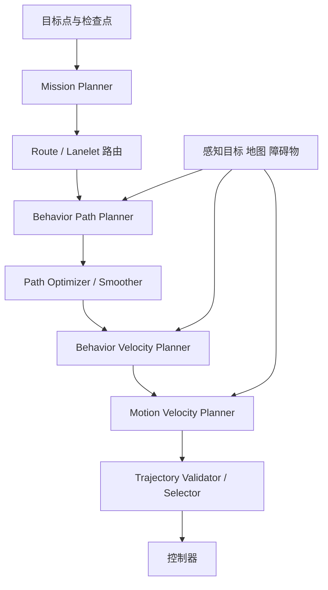
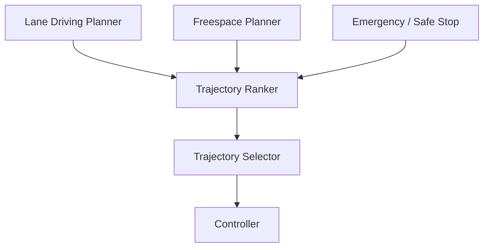

# Autoware 规划相关包功能与作用说明

**整理日期：2026-10-18**  
**范围：**用户列出的 Planning 目录包。前一组主要来自 `autoware_universe/planning`；最后一组主要来自 `autoware_core/planning`。同名包可能是迁移后的 Core 实现，实际接口应以本地 checkout 的 commit、`package.xml`、launch 和参数文件为准。

## 1. 规划系统整体职责

规划模块把“任务目标、道路地图、车辆状态、感知目标和交通规则”转换成车辆可执行的轨迹（位置、姿态、速度、加速度和时间）。典型数据流如下：

| 层次 | 解决的问题 | 代表包 |
|---|---|---|
| 任务/路由规划 | 从起点到终点经过哪些道路 | `autoware_mission_planner_universe`、Core `autoware_mission_planner` |
| 行为/路径规划 | 跟车道、换道、避障、路口通行 | `behavior_path_planner`、`autoware_manual_lane_change_handler` |
| 自由空间规划 | 没有可靠车道线时如何绕障到目标 | `autoware_freespace_planner`、`autoware_freespace_planning_algorithms` |
| 路径几何处理 | 平滑、曲率、车辆运动学和碰撞约束 | `autoware_path_smoother`、`autoware_path_optimizer` |
| 速度规划 | 停车、限速、障碍物、红绿灯、舒适性 | `behavior_velocity_planner`、`motion_velocity_planner` |
| 轨迹生成/组合 | 选择、拼接、修改、排序和验证候选轨迹 | `autoware_trajectory_*` 系列 |
| 运行时安全接口 | RTC 外部批准、周边障碍停车、限速和灯光仲裁 | `autoware_rtc_interface`、`autoware_surround_obstacle_checker` |
| Core 基础设施 | 新规划框架的基础节点、接口和测试 | `autoware_core_planning` 及 Core planning 包 |

Autoware 官方 Planning 文档把 Universe 规划模块定位为路线规划、动态障碍物规避和交通条件适应的组合系统；Diffusion Planner 则是另一种可插入的轨迹生成器。genui{"citation":{"refs":["turn2search6","turn2search0"]}}

## 2. 任务规划与路由

### 2.1 `autoware_mission_planner_universe`

- **功能：**根据当前车辆位姿、目标位姿和可选检查点，在静态地图上计算一条由车道序列组成的路线。
- **输入：**当前位姿、目标/检查点、Lanelet2 地图、地图路由图。
- **输出：**`LaneletRoute`/route，与路线状态和检查点相关的服务接口。
- **主要作用：**回答“车辆应该经过哪些道路和车道才能到达目的地”。
- **边界：**不负责动态障碍物、临时施工或实时绕障；这些由行为和速度规划处理。当前 Universe 版本主要支持 Lanelet2 地图插件。genui{"citation":{"ref":"turn2search20"}}

### 2.2 `autoware_mission_planner`（Autoware Core）

- **功能：**Core 规划框架中的任务规划实现/接口。
- **作用：**提供更解耦的任务规划逻辑，使地图格式插件、ROS 节点和规划框架分离。
- **与 Universe 版本关系：**功能目标相近，但属于 Core 仓库迁移版本；迁移时要核对 route 消息、服务名、插件加载方式和参数结构。

### 2.3 `autoware_route_handler`（Autoware Core）

- **功能：**读取、索引和查询 route 中的 Lanelet，提供当前车道、前后邻接车道、路线进度和中心线等公共能力。
- **主要作用：**被路径规划、换道、速度规划和预测模块复用，避免每个模块重复实现地图查询。
- **典型输出：**当前路线 lanelets、目标 lanelets、中心线、弧长坐标和车道关系。

### 2.4 `autoware_manual_lane_change_handler`

- **功能：**通过外部服务或 RViz 插件，将路线的“首选车道/优先 primitive”向左或向右移动。
- **主要作用：**支持人工指定换道、临时绕开车道或调试车道选择。
- **接口特点：**提供设置 preferred lane 的 service；它改变路线偏好，不直接生成最终轨迹。
- **注意：**仍需行为路径规划确认车道变化的可行性和安全性。

## 3. 行为路径规划

### 3.1 `behavior_path_planner`

这是一个由多个行为模块组成的路径规划框架，负责在 route 约束下生成横向路径。它通常处理：

- 起步/驶入道路（start planner）；
- 车道保持和基准中心线；
- 自动换道、手动换道；
- 静态障碍物绕行；
- 路口、合流、分流和交叉口行为；
- 泊车、靠边、掉头等特殊场景；
- 路径候选生成、模块优先级和冲突仲裁。

**输入：**route、Lanelet2 map、车辆 odometry/acceleration、tracked/predicted objects、交通灯、占据/可行驶区域等。  
**输出：**带路径点、车道信息、转向意图和局部 drivable area 的 path。  
**关键理解：**它主要决定“车辆横向走哪条路”，速度限制和停车时机通常由 behavior/motion velocity planner 继续处理。

### 3.2 `autoware_path_generator`（Autoware Core）

- **功能：**从 route 和车辆状态生成基础路径/中心线候选。
- **主要作用：**作为 Core 新规划框架中的路径生成基础节点，为后续行为决策和轨迹优化提供几何初值。
- **注意：**它不是完整的行为规划器，不负责所有换道和障碍规避策略。

### 3.3 `autoware_path_optimizer`

- **功能：**生成运动学可行且无碰撞的轨迹；更新轨迹位置和姿态，速度通常继承输入路径。
- **输入：**路径、drivable area、车辆形状、障碍物约束。
- **输出：**曲率、转角变化和碰撞约束更合理的路径/轨迹。
- **主要作用：**把行为模块给出的离散路径变成车辆底盘能跟踪的几何轨迹。

### 3.4 `autoware_path_smoother`

- **功能：**平滑 path 或 trajectory，降低曲率突变、航向抖动和横向 jerk。
- **主要作用：**改善控制跟踪、乘坐舒适性和轨迹连续性。
- **注意：**平滑必须受道路边界和障碍物约束；过度平滑可能让轨迹偏离车道或侵入障碍物。

### 3.5 `autoware_costmap_generator`

- **功能：**根据障碍物、地图和车辆外形生成规划用 costmap/代价区域。
- **主要作用：**把“可行驶、障碍物、膨胀安全边界、未知区域”转换为优化器或自由空间搜索可使用的代价。
- **典型输入：**occupancy grid、点云/检测目标、drivable area、车辆 footprint。
- **注意：**栅格分辨率、障碍物膨胀半径和地图原点会直接影响规划可行性。

## 4. 自由空间规划

### 4.1 `autoware_freespace_planner`

- **功能：**在没有可靠车道线的空间中，从当前位置到目标位姿规划可执行轨迹。
- **算法：**当前实现基于 `autoware_freespace_planning_algorithms` 的 Hybrid A*；未来可扩展 RRT* 等算法。genui{"citation":{"ref":"turn2search5"}}
- **输入：**route/目标位姿、occupancy grid 或 costmap、车辆 odometry、场景激活信号。
- **输出：**单方向（前进或倒车）的轨迹，并报告分段轨迹是否全部发布。
- **主要作用：**停车场、无车道道路、掉头和狭窄区域的全局/局部路径规划。
- **注意：**车辆 footprint margin、倒车代价、搜索分辨率和 replanning 条件决定是否能找到解。

### 4.2 `autoware_freespace_planning_algorithms`

- **功能：**提供自由空间搜索算法库，而不是完整 ROS 场景节点。
- **主要作用：**封装 Hybrid A* 的状态扩展、碰撞检测、启发式代价、轨迹回溯和路径平滑等算法。
- **接口定位：**由 `autoware_freespace_planner` 调用，也便于单元测试和未来替换搜索算法。

## 5. 速度规划与安全约束

### 5.1 `behavior_velocity_planner`

- **功能：**根据道路行为和交通规则修改路径速度，生成停车、减速和限速结果。
- **典型模块：**交通灯/停止线、交叉口、行人横道、障碍物停止、盲区、合流、道路施工、减速带等。
- **输入：**behavior path、地图、交通灯、tracked/predicted objects、车辆状态。
- **输出：**带速度、加速度和停止点的路径/trajectory。
- **主要作用：**回答“在哪里停、何时减速、通过路口时多快”。
- **注意：**它通常不负责改变道路拓扑；横向换道主要属于 behavior path planner。

### 5.2 `motion_velocity_planner`

- **功能：**在更接近最终轨迹的阶段，进行基于运动学、障碍物和动态约束的速度优化。
- **典型任务：**障碍物停止/减速、速度平滑、加速度/jerk 约束、局部动态目标响应。
- **作用：**将行为速度计划转换为控制器可跟踪的时序轨迹。
- **与 behavior velocity 的区别：**behavior 更关注规则和场景决策；motion 更关注连续动力学和最终速度曲线。

### 5.3 `autoware_external_velocity_limit_selector`

- **功能：**整合 API 和 Autoware 内部模块发布的外部速度限制。
- **策略：**选择最低最高速度上限，并选择最严格的减速度/jerk 约束，形成统一的“硬限制”。
- **主要作用：**确保多个限速来源不会互相覆盖，保护所有减速点和最大速度约束。
- **注意：**速度限制消息不只有 max velocity，还包含 acceleration/jerk 限制。

### 5.4 `autoware_surround_obstacle_checker`

- **功能：**监测车辆周围障碍物、姿态和其他停止条件；满足条件时发布零速度限制。
- **主要作用：**作为规划链路外侧的安全停车闸门，防止周边近距离障碍物导致车辆继续运动。
- **注意：**停止条件、障碍物距离、检测盲区和恢复逻辑需要与车辆尺寸及传感器布局匹配。

### 5.5 `autoware_remaining_distance_time_calculator`

- **功能：**计算车辆沿 route/trajectory 的剩余距离和预计剩余时间。
- **输入：**当前位姿、route/trajectory、速度或时间参数。
- **输出：**remaining distance、ETA/remaining time 等指标。
- **用途：**任务状态、HMI、远程 API、到达判断和调试；通常不直接改变轨迹。

## 6. 轨迹生成、候选处理与选择

### 6.1 `autoware_diffusion_planner`

- **功能：**基于 Diffusion Planner 模型直接生成平滑、可行、安全的轨迹。
- **输入：**odometry、acceleration、tracked objects、traffic signals、vector map、route、转向灯等。
- **输出：**规划轨迹、预测/中间结果和 debug markers。
- **模型考虑因素：**动态/静态障碍物、车辆运动学、用户约束、Lanelet2 上下文、信号灯和限速。
- **推理：**官方说明使用 ONNX Runtime；需要配置模型权重和参数目录。genui{"citation":{"ref":"turn2search0"}}
- **风险边界：**公开说明指出模型存在训练地图域差异、路线回归不稳定、静态障碍物上下文不足等限制，因此应放在验证器和安全闸门之后，而不是单独视为安全保证。

### 6.2 `autoware_trajectory_adapter`

- **功能：**把不同模块产生的 path/trajectory 转成统一的轨迹表示，补齐或重排轨迹点字段。
- **主要作用：**处理旧接口、新接口、不同采样间隔和不同轨迹消息之间的适配。
- **注意：**适配器一般不重新规划，主要是字段/坐标/采样语义转换。

### 6.3 `autoware_trajectory_concatenator`

- **功能：**把多个连续轨迹段拼接成一条时间/空间连续轨迹。
- **典型用途：**将当前已发布轨迹、下一段规划轨迹和场景切换结果平滑连接，避免控制器看到断点。
- **关键点：**连接点位置、速度、时间戳、航向和加速度连续性。

### 6.4 `autoware_trajectory_modifier`

- **功能：**对已有轨迹做通用修改，如速度、时间、横向偏移、限速、停止点或属性标记更新。
- **主要作用：**为多个规划模块提供统一的后处理入口。
- **注意：**修改器应明确优先级，避免多个模块反复覆盖同一字段。

### 6.5 `autoware_trajectory_optimizer`

- **功能：**从一个或多个候选轨迹中进行连续优化，使其更符合车辆运动学、舒适性、道路边界和障碍物约束。
- **与 path optimizer 的区别：**path optimizer 偏几何路径；trajectory optimizer 同时处理时间、速度、加速度和 jerk。
- **常见输出：**优化后的最终候选轨迹、代价和可行性状态。

### 6.6 `autoware_trajectory_ranker`

- **功能：**对多条候选轨迹按代价排序。
- **典型代价：**碰撞风险、横向偏差、曲率、加速度/jerk、路线偏离、速度效率和舒适性。
- **主要作用：**为 selector 提供确定的优先顺序；它通常不负责最终发布。

### 6.7 `autoware_trajectory_selector`

- **功能：**从多个规划器/候选轨迹中选择当前要发布给控制器的一条。
- **输入来源：**行为规划、自由空间规划、备用轨迹、紧急停止轨迹等。
- **主要作用：**在不同场景或不同 planner 同时运行时完成仲裁和切换。
- **安全重点：**没有有效候选、轨迹过期或验证失败时必须有明确 fallback 行为。

### 6.8 `autoware_trajectory_validator`

- **功能：**检查轨迹是否有效、连续、可跟踪和无明显碰撞风险。
- **典型检查：**NaN/Inf、时间单调性、点间距、速度/加速度/jerk 限制、曲率、道路边界、车辆 footprint 碰撞和轨迹过期。
- **主要作用：**在轨迹到达控制器前提供最后一道软件质量闸门。

## 7. 运行时控制、灯光与场景切换

### 7.1 `autoware_rtc_interface`

- **RTC 含义：**通常指 Runtime Traffic/Control interface，用于行为规划模块与外部系统之间的运行时批准接口。
- **功能：**发布行为模块的决策状态，并接收外部执行/批准命令。
- **主要作用：**让远程操作、上层监督器或安全系统批准/拒绝换道、绕行、交叉口通行等行为。
- **注意：**RTC 是决策协调接口，不是独立规划算法；没有批准时应由模块按参数进入等待、保持或安全降级。

### 7.2 `autoware_scenario_selector`

- **功能：**根据车辆状态、route、场景和规划条件，在 lane driving、停车、自由空间、pull-over 等场景间选择。
- **主要作用：**决定当前应该激活哪一套规划链路，避免多个相互冲突的 planner 同时控制车辆。
- **典型输出：**scenario 状态、激活标志和场景对应的轨迹源。

### 7.3 `autoware_hazard_lights_selector`

- **功能：**合并 planning 和 system 多个来源的危险警示灯命令，选择车辆最终 hazard lights 状态。
- **主要作用：**当规划停车、故障保护、紧急状态和系统诊断同时给出灯光命令时，形成一致输出。
- **注意：**属于车辆行为输出仲裁，不负责生成轨迹。

## 8. Core 规划基础包

### 8.1 `autoware_core_planning`

- **功能：**Core planning 元包/组织入口，集中管理 Core 规划组件依赖。
- **作用：**提供构建、安装、集成和启动层面的统一入口，本身通常不等于一个具体 planner。

### 8.2 `autoware_planning_factor_interface`

- **功能：**发布规划因子（planning factors），说明某个规划模块为什么改变速度、路径或停止行为。
- **典型内容：**停止原因、减速原因、影响范围、目标对象、相关车道和决策模块。
- **主要作用：**可视化、调试、评估和上层 API 解释“规划为什么这样做”。

### 8.3 `autoware_objects_of_interest_marker_interface`

- **功能：**发布规划关注对象的可视化 marker/接口信息。
- **主要作用：**标记当前影响规划的车辆、行人、障碍物、交通灯或 lanelet，帮助在 RViz 中解释决策。

### 8.4 `autoware_planning_topic_converter`

- **功能：**在不同规划消息接口之间转换，适配旧版和新版规划框架。
- **主要作用：**减少迁移期 topic/message 不兼容，通常不改变规划逻辑。

### 8.5 `autoware_planning_test_manager`

- **功能：**为规划节点提供测试管理、场景驱动和集成测试支持。
- **主要作用：**加载测试输入、驱动规划周期、收集轨迹并验证结果；不参与车辆在线规划。

### 8.6 `behavior_velocity_planner`（Autoware Core）

- **功能：**Core 版本的行为速度规划基础组件。
- **作用：**与 Universe 的行为速度模块目标相近，但面向新的 Core 接口和模块化结构；迁移时需要检查插件、参数和 planning factor 输出。

### 8.7 `motion_velocity_planner`（Autoware Core）

- **功能：**Core 版本的运动速度规划基础组件。
- **作用：**在最终轨迹上处理速度、加速度、jerk 和动态约束，与控制器接口衔接。

### 8.8 `autoware_velocity_smoother`（Autoware Core）

- **功能：**对速度序列进行平滑和约束处理。
- **输入/输出：**带速度的路径/轨迹 → 满足加速度、减速度、jerk 和舒适性约束的速度曲线。
- **主要作用：**避免速度突变，改善控制稳定性和乘坐舒适性。

## 9. 推荐组合

### 普通道路车道驾驶

### 停车场或无车道区域

### 多规划器并行

## 10. 选型与排障建议

| 需求 | 主要包 |
|---|---|
| 目的地到道路路线 | `autoware_mission_planner_universe` / Core `autoware_mission_planner` |
| 车道保持、换道、绕静态障碍 | `behavior_path_planner` |
| 停车场、掉头、无车道空间 | `autoware_freespace_planner` |
| 轨迹几何平滑 | `autoware_path_smoother`、`autoware_path_optimizer` |
| 交通灯/停止线/障碍物减速 | `behavior_velocity_planner` |
| 最终动力学速度曲线 | `motion_velocity_planner`、Core `autoware_velocity_smoother` |
| 神经网络直接生成轨迹 | `autoware_diffusion_planner` |
| 多候选轨迹仲裁 | `autoware_trajectory_ranker`、`autoware_trajectory_selector` |
| 外部监督批准行为 | `autoware_rtc_interface` |
| 周边障碍强制停车 | `autoware_surround_obstacle_checker` |
| 轨迹上线前检查 | `autoware_trajectory_validator` |

排障时优先检查：

1. route 是否有效、Lanelet2 map 是否加载完成、当前位姿是否投影到正确 lanelet；
2. odometry、TF、tracked objects、traffic signals 的时间戳是否一致；
3. path、trajectory 的坐标系、点间距、时间字段和速度方向是否正确；
4. 车辆 footprint、障碍物膨胀半径、costmap 分辨率是否导致“无解”；
5. behavior 模块和 motion 模块是否同时覆盖同一速度字段；
6. selector 是否在候选轨迹过期或验证失败时错误选择了旧轨迹；
7. Core 与 Universe 同名包的 topic、参数、插件和消息是否混用；
8. Diffusion Planner 模型路径、ONNX Runtime 版本、训练地图域和输入特征是否一致；
9. 自由空间规划的倒车/前进分段、终点姿态和障碍物膨胀参数是否合理；
10. RTC、外部速度限制和 surround obstacle checker 是否把车辆置于持续等待或零速度状态。

## 11. 官方参考

- [Autoware Universe Planning 总览](https://github.com/autowarefoundation/autoware_universe/blob/main/planning/README.md)
- [Autoware Diffusion Planner](https://github.com/autowarefoundation/autoware_universe/blob/main/planning/autoware_diffusion_planner/README.md)
- [Autoware Freespace Planner](https://github.com/autowarefoundation/autoware_universe/blob/main/planning/autoware_freespace_planner/README.md)
- [Autoware Mission Planner Universe](https://github.com/autowarefoundation/autoware_universe/blob/main/planning/autoware_mission_planner_universe/README.md)
- [Autoware Core](https://github.com/autowarefoundation/autoware_core/tree/main/planning)
- [Autoware Planning 文档站](https://autowarefoundation.github.io/autoware.universe/main/planning/)

> **版本提醒：**用户目录中 7 月 15 日的包与 9 月 30 日的 Core 包可能来自不同 commit。本文解释的是功能边界和架构角色；实际编译和运行时接口必须以本地源码、参数 YAML、节点设计文件和 launch remapping 为准。
