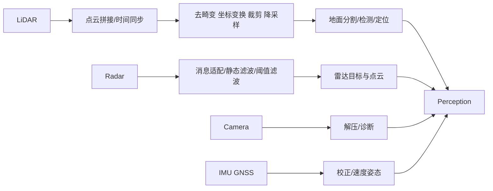
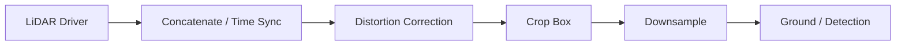
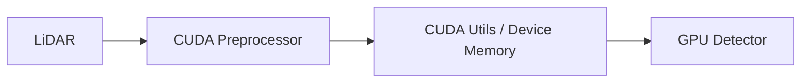
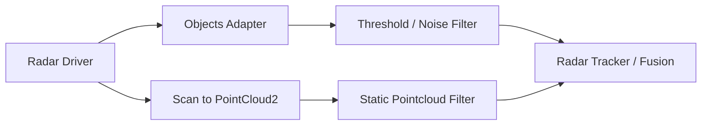

# Autoware 传感器与数据预处理相关包功能说明

**整理日期：2026-10-18**  
**范围：**用户列出的 sensing 目录包。前半部分主要来自 `autoware_universe/sensing`，后半部分来自 `autoware_core/sensing`。这些包处在“传感器驱动 → 标准化数据 → 感知算法”的入口位置，决定后续检测、跟踪和定位的数据质量与实时性。

## 1. 传感器处理总链路

| 类别 | 代表包 | 主要输出 |
|---|---|---|
| LiDAR 点云预处理 | `autoware_pointcloud_preprocessor`、`autoware_cuda_pointcloud_preprocessor` | 标准化、同步、去畸变、裁剪、降采样点云 |
| CUDA 基础设施 | `autoware_cuda_utils` | GPU 内存、stream、点云 kernel 等公共能力 |
| PCL 扩展 | `autoware_pcl_extensions` | Autoware 对 PCL 的通用封装/扩展 |
| 相机数据质量 | `autoware_image_diagnostics`、`autoware_image_transport_decompressor` | 图像诊断、解压后的 Image |
| IMU/GNSS | `autoware_imu_corrector`、`autoware_gnss_poser` | 校正后的 IMU、GNSS 姿态/位置 |
| Radar | `autoware_radar_*` | Radar objects、Radar pointcloud 和过滤结果 |
| Core 基础包 | `autoware_core_sensing`、`autoware_crop_box_filter`、`autoware_downsample_filters`、`autoware_vehicle_velocity_converter` | 可复用 sensing 节点和接口 |

Autoware 官方架构把 LiDAR 原始点云、相机、IMU 和 GNSS 作为 sensing 层输入，再交给定位、感知和规划模块；Core 与 Universe 的拆分意味着同名/相近能力可能来自不同仓库，接口不能仅凭包名假定兼容。genui{"citation":{"refs":["turn3search28","turn3search6","turn3search25"]}}

## 2. LiDAR 点云预处理

### 2.1 `autoware_pointcloud_preprocessor`

这是 LiDAR 数据进入 Autoware 后最重要的通用预处理包，通常由多个 component/node 组合使用：

- **点云拼接与时间同步：**将多个 LiDAR 的 `PointCloud2` 按时间窗口收集、变换到统一坐标系后拼接；可处理不同雷达到达时间不一致的问题。
- **去畸变（distortion correction）：**利用车辆运动/TF 和点时间字段，将扫描期间不同时间采样的点补偿到同一参考时刻，减少车辆运动造成的弯曲。
- **坐标变换：**把 sensor frame 点云转换到 `base_link`、`map` 或指定输出坐标系。
- **Crop box：**按 XYZ 边界、车辆区域、距离或镜像区域裁剪点云，去除车体、天空或无关区域。
- **Voxel/Random downsample：**降低点数和 CPU/GPU 带宽，控制感知延迟。
- **离群点与半径过滤：**去除稀疏异常点、近距离噪声或不满足密度条件的点。
- **格式与字段处理：**保持或转换 `x/y/z/intensity/ring/time` 等字段，确保下游检测器使用正确布局。

**典型输入：**驱动发布的 `sensor_msgs/msg/PointCloud2`、TF、车辆 odometry。  
**典型输出：**预处理后的点云、debug 点云、拼接后的点云和诊断状态。  
**主要作用：**把“传感器原始数据”变成感知算法可稳定消费的统一点云。官方文档和 issue 也特别强调了 output frame、concatenate/time sync、crop box 和 filter indices 等接口细节。genui{"citation":{"refs":["turn3search10","turn3search12","turn3search18"]}}

### 2.2 `autoware_cuda_pointcloud_preprocessor`

- **功能：**将点云预处理中的高计算量步骤放到 CUDA GPU 上执行。
- **典型能力：**CUDA 点云拼接、时间同步、坐标变换、crop box、随机/体素降采样等。
- **输入/输出：**与 CPU 预处理类似，但通常在 GPU 内存/blackboard 上传递，输出标准 `PointCloud2` 或 CUDA 兼容点云消息。
- **主要作用：**在高线数 LiDAR、多雷达拼接和高频感知场景中降低 CPU 占用和延迟。
- **注意：**需要 CUDA；官方 CMake 显示该包依赖 `autoware_pointcloud_preprocessor`、`autoware_cuda_utils`、`cuda_blackboard` 等，且没有 CUDA 时不会构建。genui{"citation":{"ref":"turn3search0"}}

### 2.3 `autoware_crop_box_filter`（Autoware Core）

- **功能：**按三维盒体范围过滤点云。
- **主要作用：**去除车辆本体、近场无关点、传感器安装结构或超出感知范围的点。
- **与 Universe 预处理包的关系：**Core 将常用过滤器拆成独立、可复用包；迁移时检查参数名称、输入输出 topic 和是否支持 indices。
- **关键参数：**min/max XYZ、是否保留盒内/盒外、目标 frame、动态参数更新。

### 2.4 `autoware_downsample_filters`（Autoware Core）

- **功能：**提供体素降采样、随机降采样等通用过滤器。
- **主要作用：**控制点数、内存、网络带宽和检测推理时间。
- **典型策略：**VoxelGrid 保留空间均匀性；Random downsample 计算简单但可能改变稀疏分布。
- **注意：**降采样过强会损失远处行人、细小障碍物和 ring/time 字段；过弱则增加 GPU/CPU 延迟。Core 发布说明中也包含 random downsample filter 的修复记录。genui{"citation":{"ref":"turn3search21"}}

### 2.5 `autoware_pcl_extensions`

- **功能：**Autoware 对 PCL 的扩展和公共工具封装。
- **典型用途：**点云字段操作、索引处理、聚类/滤波辅助、ROS-PCL 转换、几何和点类型适配。
- **定位：**基础库，不直接代表某个感知算法；多个 pointcloud、ground segmentation 和 clustering 包可能依赖它。

### 2.6 `autoware_cuda_utils`

- **功能：**CUDA 公共基础设施，如 device buffer、CUDA stream、错误检查、内存管理、host/device 数据转换和通用 kernel 辅助。
- **主要作用：**让 CUDA 点云预处理和 GPU 感知节点共享一致的内存/执行模型。
- **注意：**它通常不发布 ROS topic；属于编译和运行时依赖，CUDA、驱动和编译架构必须匹配。

## 3. 相机数据与诊断

### 3.1 `autoware_image_transport_decompressor`

- **功能：**将压缩图像传输格式解码为 `sensor_msgs/msg/Image`。
- **输入：**`CompressedImage` 或 image_transport 的 compressed topic。
- **输出：**原始 `Image`，通常供 YOLOX、交通灯分类、相机 3D 检测和图像-LiDAR 融合使用。
- **主要作用：**降低网络/进程间传输带宽，同时在进入 GPU 推理前恢复像素数据。
- **注意：**编码格式、颜色空间（RGB/BGR）、时间戳和 camera_info 必须保持一致；解压会增加 CPU 消耗。

### 3.2 `autoware_image_diagnostics`

- **功能：**监测图像流质量和相机工作状态。
- **典型检查：**帧率、延迟、时间戳跳变、图像尺寸/编码、黑帧、冻结帧、丢帧和传输状态。
- **主要作用：**在检测模型误报/漏报前发现相机输入异常，支持诊断状态和运维监控。
- **注意：**诊断阈值应按相机频率、曝光策略和网络链路配置，不能把正常低频相机误判为故障。

## 4. IMU、GNSS 与车辆运动状态

### 4.1 `autoware_imu_corrector`

- **功能：**修正 IMU 原始数据中的安装误差、轴方向、偏置、尺度或坐标系问题。
- **输入：**原始 `sensor_msgs/msg/Imu`，配置参数/标定值，可能包含 TF。
- **输出：**修正后的 IMU 消息。
- **主要作用：**为 EKF、NDT、GNSS 融合和去畸变提供方向、角速度和线加速度一致的输入。
- **注意：**轴向、右手系、重力方向、单位和 covariance 是最常见问题；修正参数错误会影响整个定位链路。

### 4.2 `autoware_gnss_poser`（Autoware Core）

- **功能：**把 GNSS 定位消息和姿态/航向信息转换为 Autoware 可用的 pose。
- **输入：**NavSatFix、GNSS/INS orientation、地图投影或地理参考信息。
- **输出：**map/earth 坐标系中的 pose、定位状态和相关协方差。
- **主要作用：**提供 GNSS-only 或 GNSS 融合定位的初值、全局参考和姿态信息。
- **注意：**天线杆臂、坐标系、ENU/NED、经纬度投影和 fix 状态必须一致；GNSS 失锁时下游应有降级策略。

### 4.3 `autoware_vehicle_velocity_converter`（Autoware Core）

- **功能：**在车辆速度消息、twist、轮速或底盘速度表示之间进行转换。
- **主要作用：**统一速度坐标系和字段，给定位、去畸变、控制和规划提供一致的纵向/横向速度。
- **注意：**要明确速度是在 `base_link`、车辆后轴、质心还是传感器坐标系表达；参考点不同会影响角速度换算。

## 5. Radar 数据处理

### 5.1 `autoware_radar_scan_to_pointcloud2`

- **功能：**将雷达 scan/检测结果转换成标准 `sensor_msgs/msg/PointCloud2`。
- **主要作用：**让雷达数据可以复用点云预处理、可视化、占据栅格和点云检测工具链。
- **典型字段：**位置、径向速度、RCS、目标 ID 或 radar-specific quality 字段（具体字段取决于驱动）。
- **注意：**转换时不要丢失 Doppler/radial velocity 等雷达特有信息。

### 5.2 `autoware_radar_objects_adapter`

- **功能：**把具体雷达驱动/厂商对象消息适配为 Autoware 通用 radar objects 或 perception objects。
- **主要作用：**隔离厂商消息差异，统一位置、速度、尺寸、类别、RCS、协方差和时间戳。
- **注意：**确认速度是 radial velocity 还是 Cartesian velocity，确认目标 ID 生命周期和 frame。

### 5.3 `autoware_radar_static_pointcloud_filter`

- **功能：**过滤雷达点云中的静态背景点。
- **典型方法：**使用地图/车辆运动/历史轨迹，或按速度接近零的点进行过滤。
- **主要作用：**减少护栏、建筑、路牌等静态反射对动态目标检测和跟踪的干扰。
- **注意：**低速车辆、停止车辆和相对运动估计误差可能被错误过滤。

### 5.4 `autoware_radar_threshold_filter`

- **功能：**按雷达属性阈值过滤检测点或对象。
- **典型阈值：**RCS、距离、径向速度、信号质量、置信度、点数或高度。
- **主要作用：**在进入融合和跟踪前去掉弱反射、远距离噪声和不可信目标。
- **注意：**阈值应按雷达型号、安装角度和天气调参；固定阈值跨传感器复用通常不可靠。

### 5.5 `autoware_radar_tracks_noise_filter`

- **功能：**过滤雷达 tracks 中的跳变、孤立、短寿命和不符合运动规律的噪声轨迹。
- **主要作用：**降低雷达多径、鬼影和 ID 抖动对跟踪及融合的影响。
- **典型策略：**最小 track age、速度/加速度连续性、位置跳变门限、生命周期和历史窗口。
- **注意：**过滤过强会删除真实但刚出现或急转弯的目标。

## 6. Core Sensing 元包

### 6.1 `autoware_core_sensing`

- **功能：**Autoware Core sensing 元包，组织 Core 传感器处理组件及其依赖。
- **主要作用：**统一 Core sensing 的构建、安装和系统集成入口；本身通常不执行具体滤波算法。
- **包含的典型能力：**crop box、downsample、GNSS poser、车辆速度转换等。

### 6.2 `livox`

- **功能定位：**Livox LiDAR 驱动/接口相关目录，负责从 Livox 设备获取点云、时间戳和传感器状态，并向 Autoware 发布标准 LiDAR 数据。
- **主要作用：**把 Livox 特有的非重复扫描、点字段和设备配置接入通用 `PointCloud2` 处理链。
- **注意：**Livox 点云时间字段、扫描模式、外参和驱动 QoS 会影响去畸变及多雷达同步；具体节点名称和参数需以本地目录为准。

## 7. 推荐组合

### LiDAR 感知入口

### GPU 版本

### Radar 入口

## 8. 选型与排障建议

| 需求 | 主要包 |
|---|---|
| 多 LiDAR 合并、同步和统一 frame | `autoware_pointcloud_preprocessor` |
| 高点云量、低延迟 GPU 预处理 | `autoware_cuda_pointcloud_preprocessor` |
| 去车体/范围裁剪 | `autoware_crop_box_filter` |
| 体素或随机降采样 | `autoware_downsample_filters` |
| 图像压缩传输后恢复 Image | `autoware_image_transport_decompressor` |
| 相机帧率/冻结/编码诊断 | `autoware_image_diagnostics` |
| IMU 轴向/偏置修正 | `autoware_imu_corrector` |
| GNSS 转全局 pose | `autoware_gnss_poser` |
| 速度消息统一 | `autoware_vehicle_velocity_converter` |
| Radar 对象统一 | `autoware_radar_objects_adapter` |
| Radar 转点云 | `autoware_radar_scan_to_pointcloud2` |
| Radar 静态背景过滤 | `autoware_radar_static_pointcloud_filter` |
| Radar 属性门限 | `autoware_radar_threshold_filter` |
| Radar 轨迹噪声过滤 | `autoware_radar_tracks_noise_filter` |

排障时按以下顺序检查：

1. **时间戳与 TF：**点云每个点的时间字段、消息 header、TF 和 odometry 是否覆盖同一时间范围；
2. **点云字段：**确认 `x/y/z/intensity/ring/time` 字段存在且类型正确，尤其是去畸变和 LiDAR 检测模型；
3. **输出 frame：**确认 output frame 参数已设置，变换方向没有反转；
4. **QoS 和队列：**高频 LiDAR/Radar 是否因 QoS、queue size 或同步窗口导致丢帧；
5. **裁剪/降采样：**检查是否把远处目标、坡道点或车辆附近点错误删除；
6. **GPU：**确认 CUDA、驱动、compute capability、device memory 和 host/device 拷贝延迟；
7. **相机编码：**确认 RGB/BGR、压缩格式、分辨率、CameraInfo 与模型输入一致；
8. **IMU/GNSS：**检查轴向、单位、重力、ENU/NED、天线杆臂和 covariance；
9. **Radar 速度：**区分 radial velocity 与 Cartesian velocity，检查静态点过滤是否误删停车目标；
10. **Core/Universe 混用：**同名过滤器和消息转换器必须逐项核对 topic、参数、frame 和动态参数支持。

## 9. 官方参考

- [Autoware Universe sensing 目录](https://github.com/autowarefoundation/autoware_universe/tree/main/sensing)
- [Autoware Core sensing 目录](https://github.com/autowarefoundation/autoware_core/tree/main/sensing)
- [CUDA pointcloud preprocessor CMake](https://github.com/autowarefoundation/autoware_universe/blob/main/sensing/autoware_cuda_pointcloud_preprocessor/CMakeLists.txt)
- [Autoware sensing interfaces](https://github.com/autowarefoundation/autoware-documentation/blob/main/docs/design/autoware-architecture-v1/interfaces/components/sensing.md)
- [Pointcloud preprocessor 讨论与文档入口](https://github.com/autowarefoundation/autoware_universe)

> **版本提醒：**用户目录中 7 月 15 日的 Universe 包与 9 月 30 日的 Core 包可能来自不同版本。本文说明功能边界和工程作用；具体节点名、topic、参数、字段和 launch remapping 应优先以本地源码为准。
